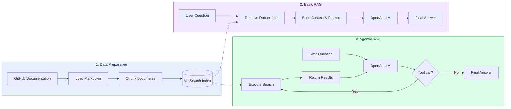

# Building RAG Systems with Python

**Basic RAG | Agentic RAG | OpenAI Function Calling**

This project explores two approaches to building Retrieval-Augmented Generation (RAG) systems in Python: a traditional RAG pipeline and an agentic workflow powered by OpenAI Function Calling.

Both implementations use the same knowledge base built from LLM Zoomcamp course documentation. While Basic RAG follows a predefined retrieval and generation pipeline, Agentic RAG allows the language model to make zero or more search calls before generating its final response.

## Architecture

Both implementations share the same document processing and indexing pipeline, but differ in how retrieval is orchestrated.



### Basic RAG vs Agentic RAG

| Feature | Basic RAG | Agentic RAG |
|---|---|---|
| Retrieval control | Python pipeline | LLM via Function Calling |
| Search calls | Exactly one | Zero or more, controlled by the LLM |
| Query formulation | Original user question | LLM-generated search queries |
| Execution flow | Fixed | Iterative |
| LLM API calls | One | Multiple possible |
| Complexity | Lower | Higher |

Basic RAG provides a simpler and more predictable execution flow, while Agentic RAG introduces flexibility by allowing the language model to decide whether, when, and how to search.

This flexibility comes with additional orchestration complexity and may result in higher latency and API costs when the model performs tool calls.

## Tech Stack

| Technology | Purpose |
|---|---|
| Python 3.12 | Application logic and RAG orchestration |
| OpenAI Responses API | LLM inference and Function Calling |
| GPT-5.4-mini | Answer generation and agent reasoning |
| MinSearch | Keyword-based document retrieval |
| GitSource | GitHub documentation ingestion |
| Jupyter Notebook | Interactive demonstrations and testing |
| uv | Dependency management and reproducible environments |

## Project Structure

```text
llm-zoomcamp-2026-course-homework-1/
├── data.py             # Document ingestion, chunking and indexing
├── rag.py              # Basic RAG pipeline
├── agent.py            # Agentic RAG with Function Calling
├── demo.ipynb          # Interactive demonstration
├── pyproject.toml      # Project dependencies
├── uv.lock             # Dependency lockfile
├── .python-version     # Python version
└── README.md           # Project documentation
```

## Getting Started

### Prerequisites

- Python 3.12
- [uv](https://docs.astral.sh/uv/)
- OpenAI API key
- Internet connection

### 1. Clone the repository

```bash
git clone https://github.com/kyivskyiartur/llm-zoomcamp-2026-course-homework-1.git
cd llm-zoomcamp-2026-course-homework-1
```

### 2. Install dependencies

```bash
uv sync --locked
```

This creates a virtual environment and installs the dependencies specified in `pyproject.toml` and `uv.lock`.

### 3. Configure your API key

Create a `.env` file in the project root:

```env
OPENAI_API_KEY=your_api_key_here
```

Never commit your `.env` file to GitHub.

### 4. Run the demonstration

Open `demo.ipynb` in VS Code or Jupyter and select the project's `.venv` Python environment.

Run the notebook cells in order:

1. **Initialize the OpenAI client** — load environment variables and configure the API client.
2. **Prepare the knowledge base** — load GitHub documentation, split documents into chunks, and build the MinSearch index.
3. **Basic RAG** — retrieve relevant documents and generate an answer.
4. **Agentic RAG** — let the LLM use Function Calling to perform zero or more searches and generate an answer.

**Note:** The first execution requires internet access to retrieve the course documentation. OpenAI API requests may incur usage costs.

## Learning Outcomes

Through this project, I gained hands-on experience with:

- **Document ingestion and processing:** Retrieving Markdown documentation from GitHub, splitting documents into overlapping chunks, and preparing them for search.
- **Information retrieval:** Building and querying a keyword-based search index using MinSearch.
- **RAG pipeline development:** Combining document retrieval, context construction, prompt engineering, and LLM-based answer generation.
- **OpenAI Function Calling:** Defining a search tool with JSON Schema, processing tool calls, and returning search results to the model.
- **Agent orchestration:** Implementing an iterative agent loop in which the LLM can perform zero or more searches before generating a response.

## Credits

This project was developed as part of [LLM Zoomcamp 2026](https://github.com/DataTalksClub/llm-zoomcamp), a free course by [DataTalksClub](https://github.com/DataTalksClub).

Special thanks to [Alexey Grigorev](https://github.com/alexeygrigorev) and the DataTalksClub community for creating and maintaining the course materials.
